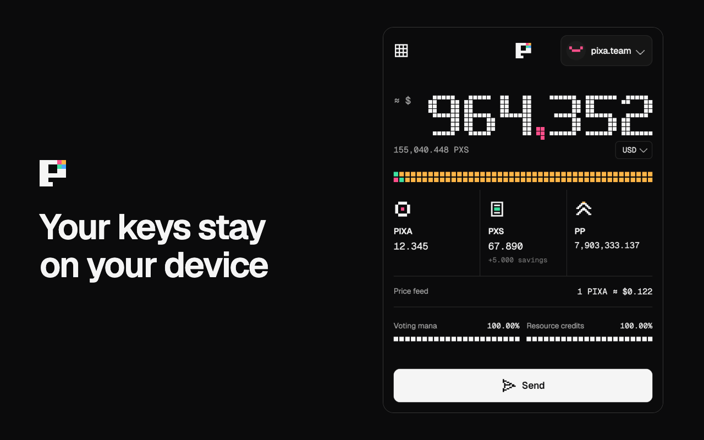
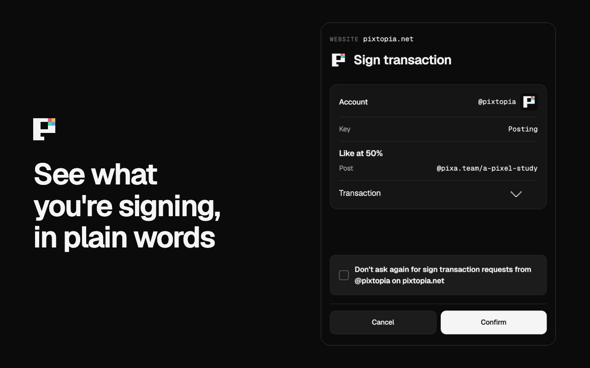
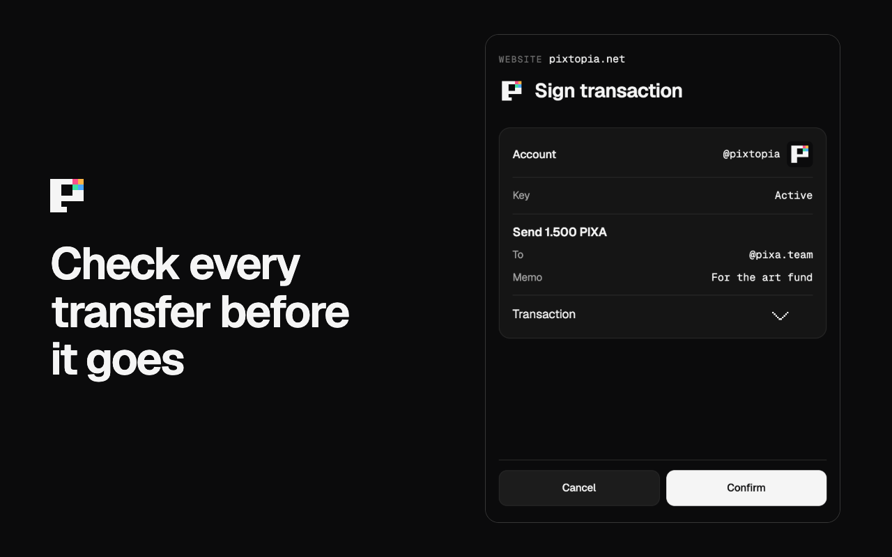
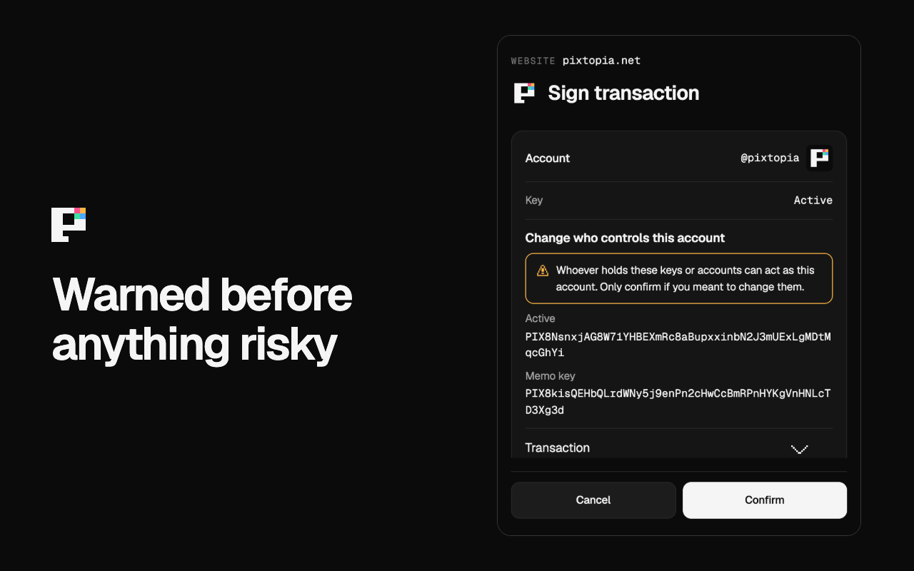

<p align="center">
  
</p>

<h1 align="center">PIXA Keychain</h1>

<p align="center">
  A wallet for the Pixa blockchain, in your browser.<br>
  Your keys stay on your device, and you see what you're signing in plain words.
</p>

<p align="center">
  <a href="https://github.com/elmerlin/pixa-keychain/releases/latest"></a>
  <a href="https://github.com/elmerlin/pixa-keychain/actions/workflows/ci.yml"></a>
  <a href="LICENSE"></a>
</p>

<p align="center">
  <a href="https://pixtopia.net/keychain">Website</a> ·
  <a href="#install-it">Install it</a> ·
  <a href="https://pixtopia.net/keychain/developers">Add it to your site</a> ·
  <a href="SECURITY.md">Report a security problem</a> ·
  <a href="https://pixtopia.net/keychain/privacy">Privacy</a>
</p>

<table>
  <tr>
    <td></td>
    <td></td>
  </tr>
  <tr>
    <td></td>
    <td></td>
  </tr>
</table>

> [!IMPORTANT]
> This is an early release, and it hasn't had an outside security audit. Start with small amounts, and
> keep a copy of your keys somewhere safe. We can't recover them for you.

## What it does

- **Holds your keys.** Encrypted with your password, on your device. Sites never see them.
- **Signs for sites.** Sign in to Pixa sites and approve likes, posts and transfers without typing a key.
- **Says what you're signing.** Every request shows the account, the key it needs and what it does, with the exact
  transaction a tap away. A request it can't read says so, and can't be approved in advance.
- **Runs your wallet.** Send PIXA and PXS, use savings, power up and down, delegate, convert, and set up recurring
  transfers.
- **Takes part in governance.** Vote for witnesses and proposals, set a proxy, or run your own witness.
- **Works for you while it's unlocked.** If you turn them on, it claims rewards, savings interest and account tickets.
- **Shows what it's roughly worth.** Your value and PIXA's price feed, in any of 30 currencies.

It keeps several accounts, each with its own history, in dark or light, and you can choose your own Pixa node. It has
no ads and no analytics, and it sends nothing to us.

## Install it

You'll need a Pixa account, which you can make at [pixagram.com](https://pixagram.com). Add it to the wallet with a key
or your master password.

**Chrome Web Store:** coming soon.

**From a release**, for Chrome and other Chromium browsers (version 111 or newer):

1. Download the zip from the [latest release](https://github.com/elmerlin/pixa-keychain/releases/latest) and unzip it.
2. Open `chrome://extensions` and turn on **Developer mode**.
3. Choose **Load unpacked** and pick the unzipped folder.

This way doesn't update itself. To update, replace the folder's contents and press reload on the extension. Your
accounts stay as long as you don't remove the extension or move it to a different folder.

**From source:**

```bash
git clone https://github.com/elmerlin/pixa-keychain.git
cd pixa-keychain
npm ci
npm run build:chromium
```

Then load `dist-prod` as above.

**Firefox:** `npm run build:firefox` makes a build you can load from `about:debugging`, but it hasn't been tested yet.
We'd welcome reports.

It can sit next to Hive Keychain in the same browser. They use different names on the page.

## Use it from a site

The extension adds `window.pixa_keychain` to every `https://` page, and sites ask it to sign:

```js
window.pixa_keychain.requestVote(account, permlink, author, 10000, (response) => {
  console.log(response.success, response.result);
});
```

[The developer guide](https://pixtopia.net/keychain/developers) shows how to sign people in, with the code for your server,
and lets you try it live. [docs/api.md](docs/api.md) has every request, and how to detect the extension. If your site already works with Hive
Keychain, you mostly need to rename its one global and use Pixa's tokens.

## How your keys are kept

- Your accounts are encrypted with AES-GCM, using a key derived from your password with 600,000 rounds of PBKDF2. The
  password itself is never saved, and it's held in memory only while the wallet is unlocked.
- The wallet locks itself after 10 idle minutes. You can change that in Settings.
- Owner keys are always refused. Keep yours offline.
- A site gets only what you approve: a signature, an account name, a result. Never a key. "Don't ask again" covers one
  kind of request on one site, only ever with the posting key.
- It talks only to the Pixa node you chose (`api.pixagram.com` unless you change it). If that node stops answering, it asks
  before switching, unless you've turned on automatic switching.
- To show what things are worth, it also reads the US Big Mac price that Pixa's feed sets 1 PXS to, from
  [The Economist's data](https://github.com/TheEconomist/big-mac-data) on GitHub, at most once a week. If you pick a currency
  other than US dollars, it gets exchange rates from [frankfurter.dev](https://frankfurter.dev) too. They see your IP address
  and nothing else.

[SECURITY.md](SECURITY.md) has more, including what it can't protect you from.

## How it differs from Hive Keychain

PIXA Keychain is a fork of [Hive Keychain](https://github.com/hive-keychain/hive-keychain-extension), ported to Pixa
and given Pixtopia's look. It signs with Pixa's chain ID and `PIX` keys, uses `PIXA` and `PXS`, and refuses a request in
`HIVE` or `HBD`.

Sign requests are described in plain words, and what can't be read is treated as a warning. Other new work: automatic
account tickets priced from the chain, and a Send that never reports a sent transfer as failed.

Left out because they can't work on Pixa: Hive Engine tokens, swaps, buying coins, multisig, Ledger, PeakD notifications
and upstream's analytics. Nothing here calls a Hive service.

## Develop

```bash
npm run dev:chromium     # builds to dist-dev and rebuilds on change
npm test
npm run typecheck
npm run check:chain      # compares every operation's bytes with the node's
node scripts/e2e.mjs     # drives the real extension in Chrome and saves screenshots to .e2e
npm run package:chromium # the zip for a release or the store
```

Neither of the chain tools can broadcast. `check:chain` only makes read-only calls, and `e2e.mjs` runs the browser behind
a local proxy that refuses broadcasts and blocks everything else.

[CONTRIBUTING.md](CONTRIBUTING.md) explains how to send a change. [AGENTS.md](AGENTS.md) has the chain's differences from
Hive and the rules of the codebase, and [DESIGN.md](DESIGN.md) the look.

## Check a release

A wallet should be something you can check. To compare a release with its source, build the same tag and compare the
files:

```bash
git clone --branch vX.Y.Z --depth 1 https://github.com/elmerlin/pixa-keychain.git
cd pixa-keychain
nvm use
npm ci
npm run package:chromium
unzip -q /path/to/downloaded/pixa-keychain-X.Y.Z-chromium.zip -d /tmp/released
unzip -q pixa-keychain-X.Y.Z-chromium.zip -d /tmp/built
diff -r /tmp/released /tmp/built
```

No output means they match. Each release also lists the zip's SHA-256.

## Credits and license

MIT, see [LICENSE](LICENSE). The wallet is built on Hive Keychain, copyright Hive Keychain Ltd., and we're grateful for it.
`hive-tx` is copyright its authors ([vendor/hive-tx/LICENSE](vendor/hive-tx/LICENSE)), and Geist is under the
[SIL Open Font License](public/assets/fonts/geist-LICENSE.txt). Each release's zip includes the licenses of everything
bundled into it, in `THIRD-PARTY-LICENSES.txt`.

If you publish a fork, please give it your own name and logo, so nobody mistakes it for this wallet.
